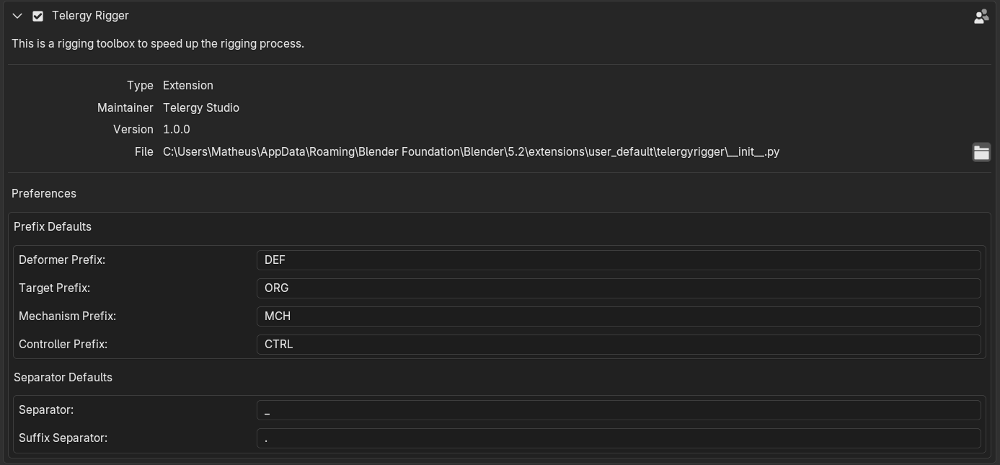
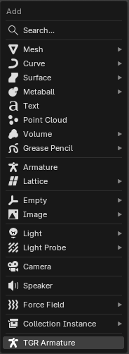
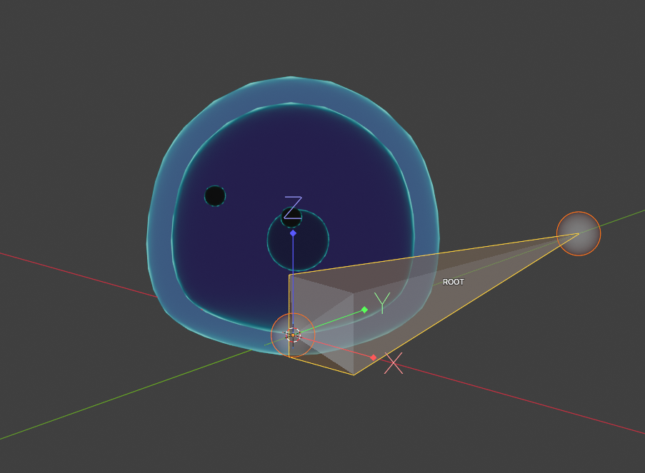
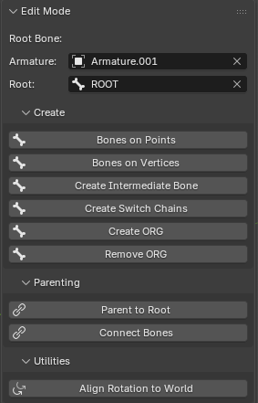
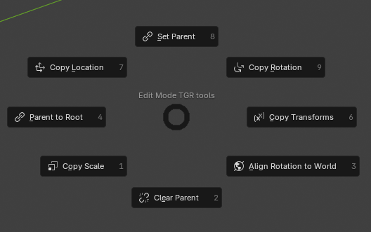
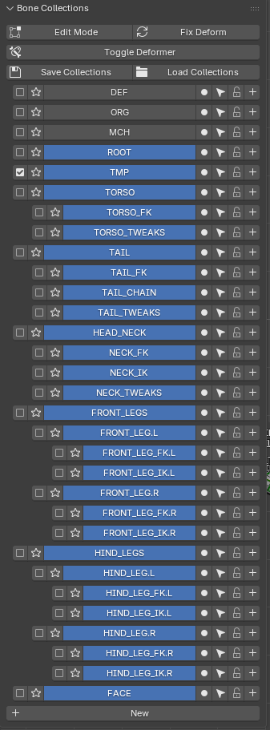
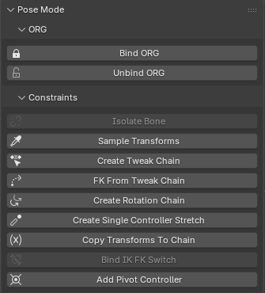
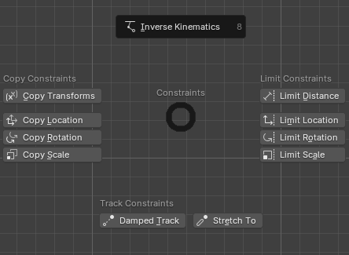
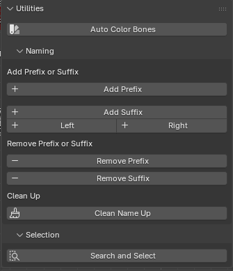

# Telergy Rigger

Telergy Rigger is a Blender addon for building, organizing, and automating rigging workflows around a clear collection-based structure. The current codebase focuses on a modern TGR rig setup with a root armature, bone collections, ORG/MCH/CTRL naming conventions, pose-mode rig helpers, and a node-based UI generation workflow.

This project is intended for Blender riggers who want a structured way to create deform bones, control bones, helper bones, and custom rig interfaces without manually rebuilding the same setup every time.

## Donations

If you find this addon useful, consider supporting its development through donations.

## Features

- Create a TGR armature with a root bone and default collection layout
- Manage bone organization through collections and collection-based controls
- Add deform and non-deform bones directly from edit mode
- Build rigs with ORG-based helpers, rotation chains, tweak chains, and switch logic
- Use pose-mode utilities for IK, transform sampling, isolate bone behavior, and pivot controls
- Rename, select, auto-color, and organize bones with utility operators
- Generate custom rig UI layouts from node-based editor graphs
- Configure default naming prefixes and separators from addon preferences

## Installation

1. Download the addon as a zip archive.
2. Open Blender.
3. Go to Edit > Preferences > Add-ons.
4. Click Install and select the addon zip file.
5. Enable the addon in the list.
6. You can now create a rig from Add > Armature > TGR Armature.

## Quick Start

### Create a TGR armature

In Object Mode, use Add > Armature > TGR Armature.

This creates:

- a root bone named ROOT
- the default TGR collection structure
- armature display settings tuned for rigging work
- a basic setup ready for editing and rig-building

### Naming conventions

The addon expects a clear prefix-driven naming system. The defaults are configured in the addon preferences and can be adjusted per project:

- DEF: deformation bones that drive the mesh
- ORG: organization/target bones used for setup, offsets, and targets
- MCH: mechanism/helper bones used for automation and rig logic
- CTRL: controller bones for user-facing animation control

This convention helps maintain a readable rig hierarchy and makes pose, selection, and collection tools much easier to work with.

## Main workflow

### Edit Mode tools

The edit-mode panel contains the core rig construction tools. Common operations include:

- Add Deform Bone — creates a new deforming bone at the cursor for the main mesh skeleton.
- Add Non-Deform Bone — creates helper or target bones that do not affect deformation.
- Align Bone to World — resets the active bone to the global orientation so it follows world axes.
- Bones on Points — creates a bone at each selected joint position to build a clean chain or intermediate structure.
- Bones on Vertices — generates bones based on vertex-based references when you are working from mesh-driven topology.
- Create Intermediate Bone — inserts a helper bone between existing bones for offsets, mechanics, or control spacing.
- Create Switch Chains — builds 3 copies of the selected chain of bones ready for IK FK switching.
- Create ORG — creates organization bones that keep rig setup separate from the actual deformation chain.
- Remove ORG — deletes the generated ORG setup when a section is no longer needed.
- Parent to Root — parents selected bones to the armature root for consistent hierarchy organization.
- Connect Bones — links bones with a head-to-tail relationship for cleaner mechanical connections.

These tools help establish skeletal structure before the rig is driven in pose mode.

In edit mode, you also have access to a pie menu for quick bone parenting and orientation

### Bone Collections

The addon uses bone collections as the primary organization system. This is a more modern structure than older per-layer conventions and is designed for a cleaner rig hierarchy.

Key collection features include:

- Active collection selection — chooses which collection is currently driving the rig setup.
- Solo and visibility toggles — isolate or hide specific collection groups while building the rig.
- Lock states — prevent accidental selection or editing of bones from a locked collection.
- Collection creation and renaming — add new rig groups and keep naming consistent as the setup grows.
- Assigning selected bones to a collection — puts bones into the correct rig group without manual cleanup later.
- Saving and loading collection layouts — keeps a reusable rig organization state between sessions.
- Deformer toggling and deform fix utilities — helps keep the animation rig clean and stable.

This panel is central to keeping large rigs readable and manageable.

### Pose Mode tools

The pose-mode panel focuses on rig behavior and control setup. Common operators include:

- Bind ORG — attaches ORG-based setup to the rig so helper transforms drive the correct target structure.
- Unbind ORG — removes that binding when the setup needs to be replaced or cleaned up.
- Isolate Bone — keeps a bone's local orientation stable while the parent continues to move.
- Sample Transforms — samples the world transforms of a bone for use as a reference.
- Create Tweak Chain — creates tweak bones that can use stretch or damped track inside of a bone chain.
- FK from Tweak Chain — uses the tweak chain to create a new FK-style control layout.
- Create Rotation Chain — creates a rotational hierarchy for cleaner, controlled chain motion.
- Create Single Controller Stretch — adds a control to the tip of the chain of selected bones, that allows for simple stretch behavior.
- Copy Transforms to Chain — replicates transforms across a matching chain based on prefix naming.
- Bind Switch — uses a data-path to drive IK FK switching chains.
- Add Pivot Controller — adds a pivot-driven controller for localized rotation and motion handling.
- Create IK Chain — builds an inverse-kinematics setup for limbs and connected chains.
- Create IK Pole Target — creates a pole target so IK chains like elbows and knees orient correctly. (deprecated)

These operations are intended for building clean control systems around a rig while keeping the deformation setup organized.

In pose mode, you also have access to a pie menu for quick constraints.

### Utilities

The utilities area includes support for:

- Naming prefixes and suffixes — adds or removes rig naming conventions such as DEF, ORG, MCH, or CTRL.
- Cleaning names — standardizes bone naming and fixes separators so the rig remains readable and consistent.
- Selecting bones by name — finds bones quickly across a large hierarchy using string matching.
- Auto-coloring bones — assigns consistent colors for cleaner visual hierarchy and easier debugging.
- General selection shortcuts — helps you grab the right bone groups without manually searching through the armature.

This reduces repetitive cleanup work when a rig grows in size.

## Node-based Rig UI generation (Under Development)

The codebase includes a node editor system for building custom UI layouts. This is one of the more significant additions versus the older documentation and is implemented through the node tree and compilation modules.

The node editor lets you build UI structures using nodes such as:

- panel nodes
- rows, columns, boxes, splits, and grids
- value nodes and custom property nodes
- operator nodes
- bone collection nodes
- labels and layout elements

Once the layout is configured, the project can generate Python code that creates a matching UI. This is useful for building custom rig control panels that stay consistent with the rig structure.

## Preferences

The addon preferences expose the default naming values used across the rigging workflow:

- Deformer Prefix
- ORG Prefix
- MCH Prefix
- CTRL Prefix
- Separator
- Suffix Separator

These defaults are helpful when you want a consistent naming convention for every armature created from TGR.

## Typical rigging pipeline

1. Create a TGR armature.
2. Build the deform hierarchy and helper structure in Edit Mode.
3. Use bone collections to organize the rig by responsibility.
4. Create ORG or MCH setup where needed.
5. Add control logic in Pose Mode with chains, switches, IK, and constraints.
6. Generate or refine a custom UI for user-facing controls.
7. Use naming and selection utilities to keep the rig clean and readable.

## Discord

If you have questions, want to report bugs, or discuss rigging workflows, join the Discord server: [https://discord.gg/h42TdeN5Rb](https://discord.gg/h42TdeN5Rb)

## Notes

This README reflects the current addon structure and may differ from older legacy documentation. Some older operator names and workflow descriptions from earlier TGR versions are no longer the main representation of the project.

For the latest behavior, it is best to inspect the current source modules in the addon itself, especially the operators, preferences, and UI panels.

